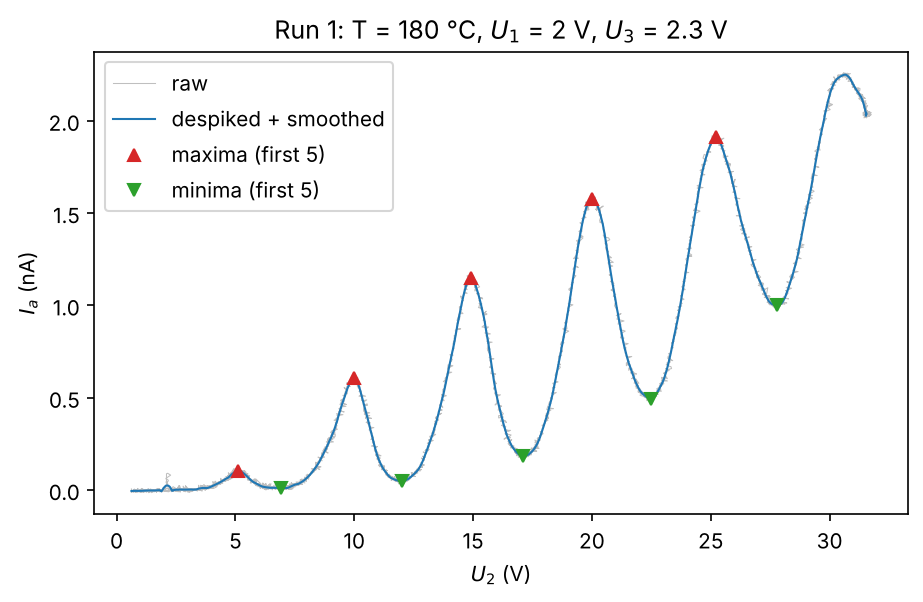
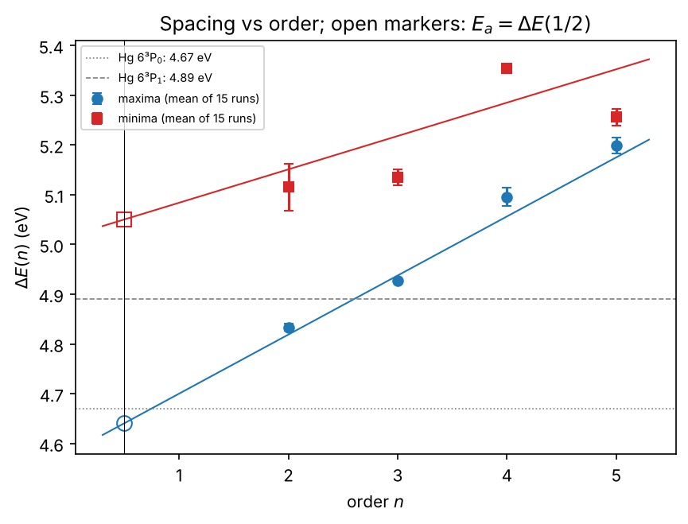
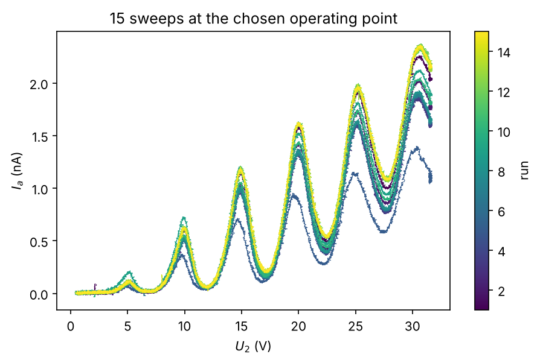

# Franck–Hertz experiment: the first excitation energy of mercury

Analysis of 15 anode-current sweeps from a mercury Franck–Hertz tube: choosing the
operating point from calibration scans, extracting extremum positions from noisy data,
and fitting the growth of the extremum spacings to obtain the excitation energy, with
a full treatment of correlated and systematic uncertainties.

ETH Physics Laboratory, Semester 7



## Result

| | E_a (eV) | stat. | syst. (smoothing) | total | closest Hg level | deviation |
|---|---|---|---|---|---|---|
| **from the maxima** | **4.641** | 0.036 | 0.029 | **0.046** | 6³P₀, 4.67 eV | −0.6 σ |
| from the minima | 5.05 | 0.27 | 0.07 | 0.28 | 6³P₁, 4.89 eV | +0.6 σ |

The maxima give **E_a = 4.64 ± 0.05 eV**, consistent with excitation of the 6³P₀
level and incompatible with 6³P₁ (5.4 σ away). The fitted mean free path is
λ/L = 0.013 ± 0.002 of the accelerating distance. The minima give a much weaker
result (see below).

## The question

When electrons are accelerated through mercury vapour, the anode current drops each
time they gain enough energy to excite a Hg atom, producing a series of maxima and
minima. The naive expectation is that successive extrema are spaced by exactly the
excitation energy. In practice the spacing **grows with order**, because electrons
keep accelerating over their mean free path λ before colliding. Rapior et al. model
the spacing between extremum n−1 and n as

  ΔE(n) = [1 + (2n − 1) λ/L] · E_a,

so the excitation energy is the extrapolation to n = ½.



## Method

1. **Operating point.** Scans over oven temperature (160–180 °C), control-grid voltage
   U₁ and braking voltage U₃, scored by peak contrast C = (I_max − I_min)/(I_max + I_min)
   and SNR on the orders visible in every setting, with a check for ADC clipping.
   Chosen: T = 180 °C, U₁ = 2.0 V, U₃ = 2.3 V (mean contrast 0.57).
2. **Peak finding.** Despiking against a running median, Savitzky–Golay smoothing of
   both the signal and the (noisy) voltage axis, then peak detection with prominence,
   minimum separation and end-of-sweep cuts.
3. **Fit.** Weighted least squares on the mean spacings over 15 runs, with errors scaled
   by √(χ²/ndf) where χ²/ndf > 1 (PDG convention).
4. **Correlations.** Adjacent spacings share an extremum and are correlated (up to
   ρ = −0.86). Refitting with the full covariance matrix and the generalised
   χ² = rᵀV⁻¹r moves E_a(maxima) to 4.611 ± 0.034 eV, inside the quoted total uncertainty.
5. **Systematics.** The whole extraction and fit is repeated for smoothing windows of
   0.3–1.2 V. Half the spread of E_a is taken as a systematic uncertainty.
6. **Outlier.** Run 5 is offset from the other runs by 6–15 σ in its maxima positions
   (visible as the low curve below). Removing it shifts E_a(maxima) by only −0.015 eV,
   so it is kept.



## Limitations

- **The minima are not reliable here.** Their fit has χ²/ndf ≈ 55 and E_a moves from
  4.93 to 5.07 eV depending on the smoothing window. The minima are shallower and broader
  than the maxima, so their positions depend much more on the smoothing.
- **χ²/ndf > 1 even for the maxima** (≈ 8 with independent errors, ≈ 14 with the full
  covariance). Either the linear model does not fully describe the spacings at this
  precision, or the run-to-run scatter underestimates the true uncertainty on the mean
  positions, e.g. because of slow drift between runs. The error scaling covers this but
  does not explain it.
- **Planck's constant is not measured independently.** Computing h = E_a λ / c requires
  assigning a line from the measured energy, so it only restates the comparison of
  E_a with the level energy (−0.6 % from the literature value of h for the maxima).

## Repository structure

```
analysis.ipynb      the full analysis, executed, with all tables and figures
fh_analysis.py      loading, despiking, peak finding, contrast/SNR, model and fits
data/calibration/   operating-point scans: scanN_T<°C>_U1-<V>_U3-<V>.dat
data/final/         the 15 sweeps used for the result (run01–run15)
figures/            figures written by the notebook
```

Data files: whitespace-separated columns. Column 1 is U₂/10 (the interface records U₂
through a 1:10 divider), column 2 is the anode signal in V (1 V ≙ 1 nA). Column 0 is
not used.

## Running it

```bash
pip install -r requirements.txt
jupyter lab analysis.ipynb
```

## Reference

G. Rapior, K. Sengstock and V. Baev, *New features of the Franck–Hertz experiment*,
Am. J. Phys. **74**, 423–428 (2006). [doi:10.1119/1.2174033](https://doi.org/10.1119/1.2174033)
